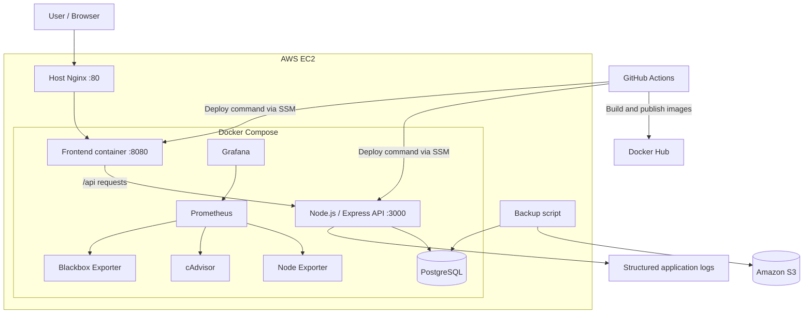

# Architecture

## Overview

The project uses Docker Compose to run the frontend, API, PostgreSQL
database, and monitoring components. On the EC2 host, Nginx receives
public HTTP requests and proxies them to the frontend container. The
frontend sends `/api` requests through its Nginx configuration to the
API service.

## Component Diagram

## Request Flow

1.  A user opens the application through the EC2 host's Nginx reverse
    proxy.
2.  Host Nginx forwards the request to the frontend container.
3.  The frontend serves the application and forwards `/api` requests to
    the Express API.
4.  The API validates requests and reads or writes application data in
    PostgreSQL.
5.  Order creation validates quantity and available stock, records the
    order, and uses an idempotency key to avoid duplicate processing.
6.  Administrative operations require the configured admin token and
    generate audit records.

## Delivery Flow

1.  A change is pushed to the GitHub repository.
2.  GitHub Actions runs code-quality checks, tests, and frontend build
    checks.
3.  The workflow builds and publishes version-tagged API and frontend
    container images to Docker Hub.
4.  The deployment job sends commands to the EC2 instance through AWS
    Systems Manager.
5.  The instance pulls the selected image tags, recreates the API and
    frontend containers, and checks their health endpoints.

## Data Protection and Operations

- PostgreSQL data is stored in a persistent Docker volume.
- The backup script creates database backups and uploads them to the
  configured private S3 bucket.
- Prometheus collects monitoring data and Grafana provides dashboards.
- See [RUNBOOK.md](RUNBOOK.md) for operational commands and recovery
  steps.

## Security Notes

- Keep `.env` and deployment secrets out of Git.
- Keep database and internal monitoring ports private; expose only the
  required public entry point.
- Use an EC2 IAM role with only the permissions required by the
  deployment and backup tasks.
- The documented deployment currently uses HTTP at the host Nginx
  entry point. HTTPS must be separately configured and tested before
  claiming TLS support.
